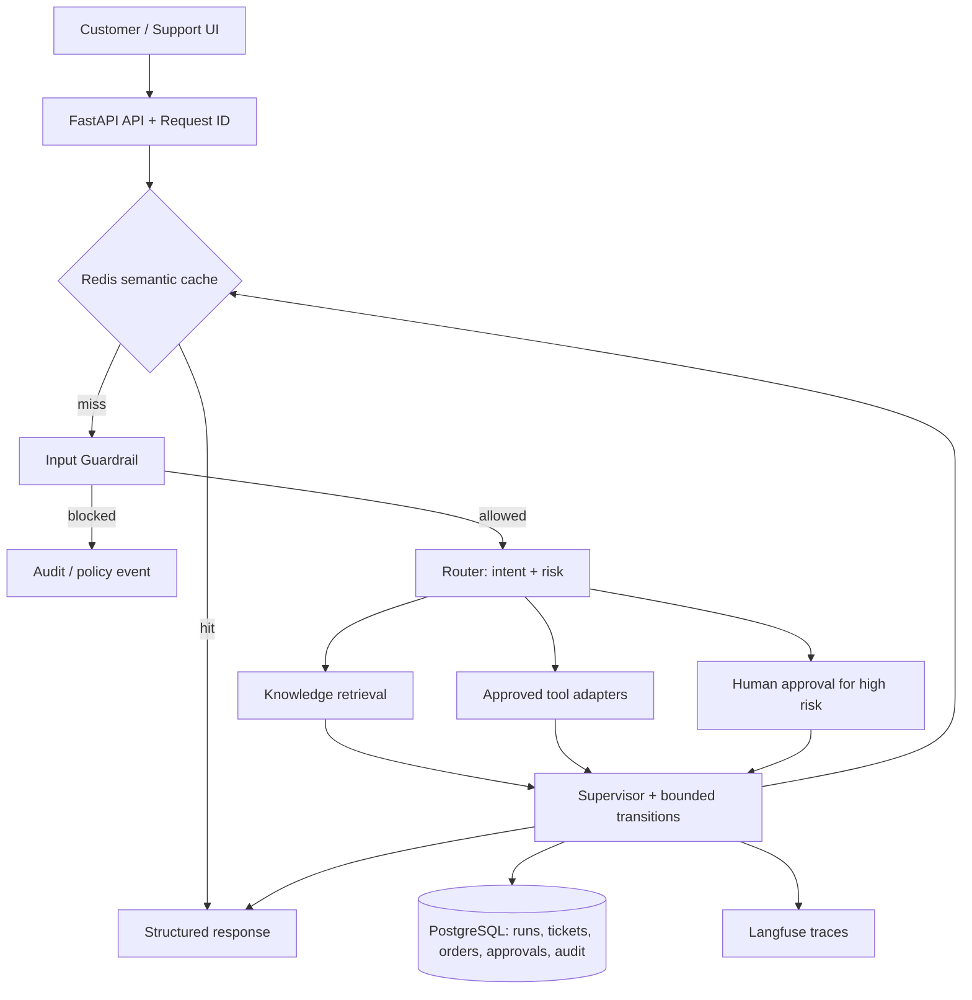

# SentinelFlow architecture

The current implementation includes an executable LangGraph flow for input inspection, intent routing, mock order status, safe knowledge demo answers, and high-risk escalation. PostgreSQL models and Alembic migrations are present, and approval decisions plus their audit records are persisted through the approval service and token-protected API. The configured token and actor ID are demo-level controls, not production identity or authorization. Full workflow repository/checkpoint integration, production embeddings/vector index, aggregate metrics, and a dedicated operator frontend remain follow-up work. See system-design.md for the implementation-status and private-beta readiness review.
