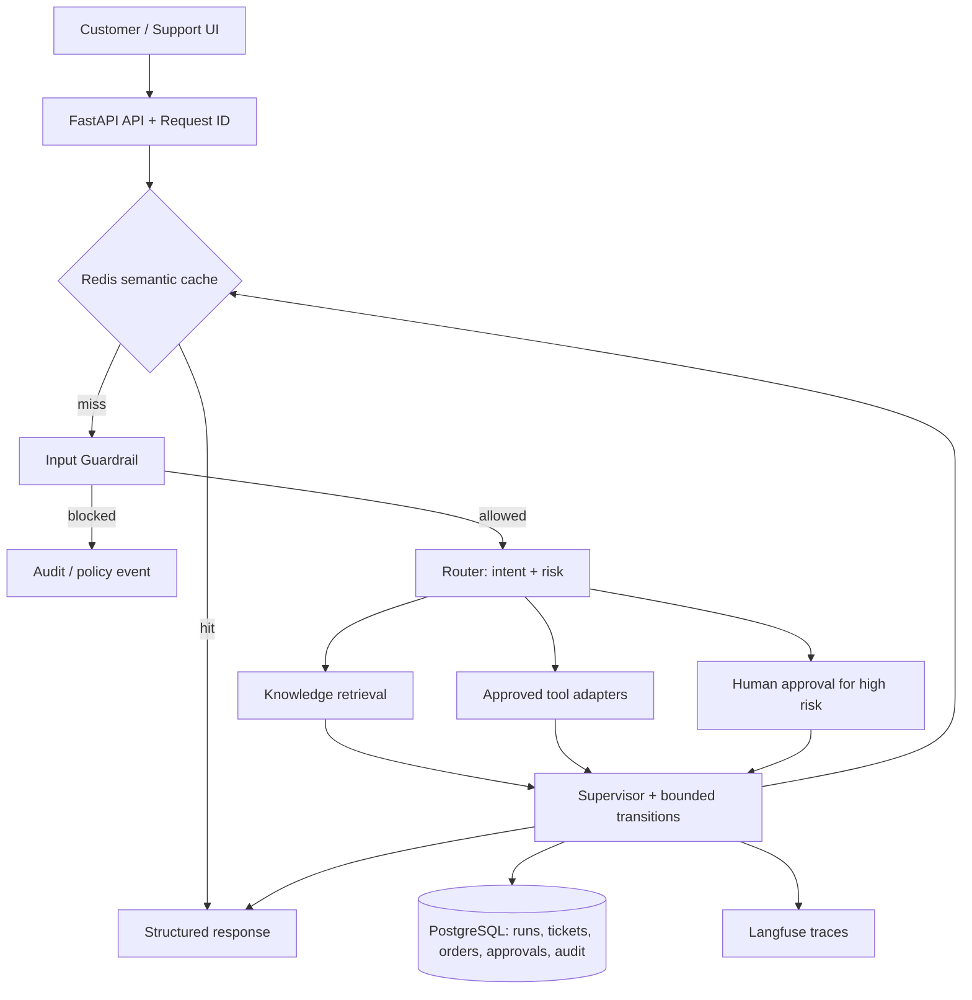

# SentinelFlow architecture

The current scaffold includes an executable LangGraph flow for input inspection, intent routing, mock order status, safe knowledge demo answers, and high-risk escalation. PostgreSQL models and Redis cache adapter are present, but durable repository/checkpoint integration, authenticated approval decisions, production embeddings/vector index, and aggregate metrics are explicit follow-up work—not represented as completed features.
